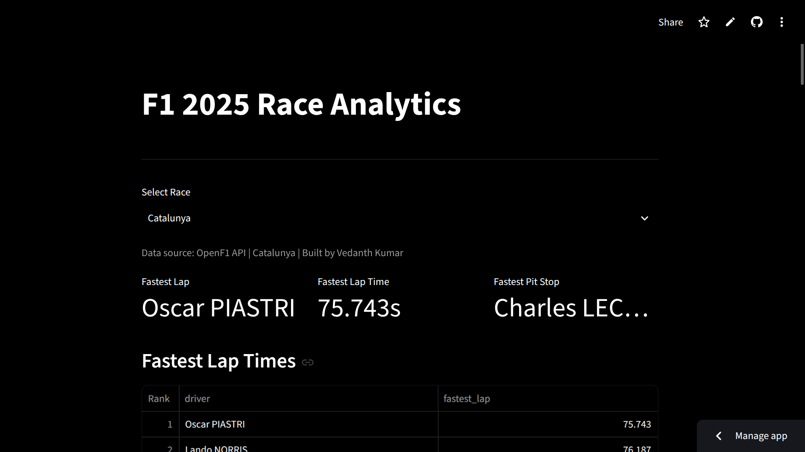

# F1 Analytics

An F1 2025 race analytics pipeline that ingests OpenF1 data into PostgreSQL (Neon) and visualizes it in a Streamlit dashboard.

## Live Demo

[View the dashboard](https://vedanthkumar17-f1-analytics.streamlit.app/)

## Screenshot



## Features

- Fastest lap per driver
- Average pit stop duration per driver
- Average lap time per team

## Tech Stack

- Python, pandas
- SQLAlchemy, psycopg2 (ingest), psycopg
- PostgreSQL (Neon)
- Streamlit, Plotly
- OpenF1 API

## Architecture

```
OpenF1 API
    |
    v
ingest.py  --(upsert)-->  PostgreSQL on Neon
                                |
                                v
                    Streamlit (dashboard.py)
                                |
                          data.py  ->  db.py
```

- `ingest.py` fetches 2025 Race sessions, drivers, laps, and pit stops from the OpenF1 API and upserts them into Neon (safe to re-run).
- `data.py` reads from Neon with parameterized SQL via SQLAlchemy and exposes `get_season_races`, `get_drivers`, `get_laps`, and `get_pit_stops`.
- `db.py` resolves `DATABASE_URL` from the environment, falling back to Streamlit secrets.
- `dashboard.py` renders the Streamlit + Plotly UI on top of `data.py`.

## Project Structure

```
f1-analytics/
├── dashboard.py          # Streamlit app
├── data.py               # Neon data-access layer (cached SQL queries)
├── db.py                 # DATABASE_URL config helper
├── ingest.py             # OpenF1 API -> Neon ingestion
├── requirements.txt
├── .env.example          # Placeholder DATABASE_URL
├── .streamlit/
│   ├── config.toml
│   └── secrets.toml      # gitignored; holds DATABASE_URL for deployment
└── sql/
    ├── schema.sql        # Tables, keys, indexes
    └── views.sql         # Analytics views
```

## Database Schema

Tables:

- **sessions** — PK `session_key`; `circuit_short_name`, `country_name`, `session_name`, `year`.
- **drivers** — PK `(session_key, driver_number)`; FK `session_key` -> `sessions`; `full_name`, `name_acronym`, `first_name`, `last_name`, `team_name`.
- **laps** — PK `id`; FK `(session_key, driver_number)` -> `drivers`; unique `(session_key, driver_number, lap_number)`; `duration_sector_1/2/3`, `lap_duration`, `st_speed`, `is_pit_out_lap`.
- **pit_stops** — PK `id`; FK `(session_key, driver_number)` -> `drivers`; unique `(session_key, driver_number, lap_number)`; `stop_duration`, `lane_duration`.

Views (`sql/views.sql`):

- **v_fastest_lap_per_driver** — fastest lap per driver per session.
- **v_avg_pit_stop_per_driver** — average pit stop per driver per session.
- **v_avg_lap_time_per_team** — average lap time per team per session.

Lap-based views exclude pit-out laps, rows with null sector times or `lap_duration`, and `lap_duration >= 150`.

## Setup

```bash
# 1. Clone
git clone https://github.com/your-username/f1-analytics.git
cd f1-analytics

# 2. Create and activate a virtual environment
python -m venv .venv
source .venv/bin/activate

# 3. Install dependencies
pip install -r requirements.txt

# 4. Configure the database URL
cp .env.example .env
# edit .env and set DATABASE_URL to your Neon connection string

# 5. Create tables and views (run against your Neon database)
psql "$DATABASE_URL" -f sql/schema.sql
psql "$DATABASE_URL" -f sql/views.sql

# 6. Ingest data from the OpenF1 API
python ingest.py            # all 2025 Race sessions
python ingest.py --limit 3  # only the first 3 sessions

# 7. Run the dashboard
streamlit run dashboard.py
```

For deployment, set `DATABASE_URL` in `.streamlit/secrets.toml` instead of `.env`.
